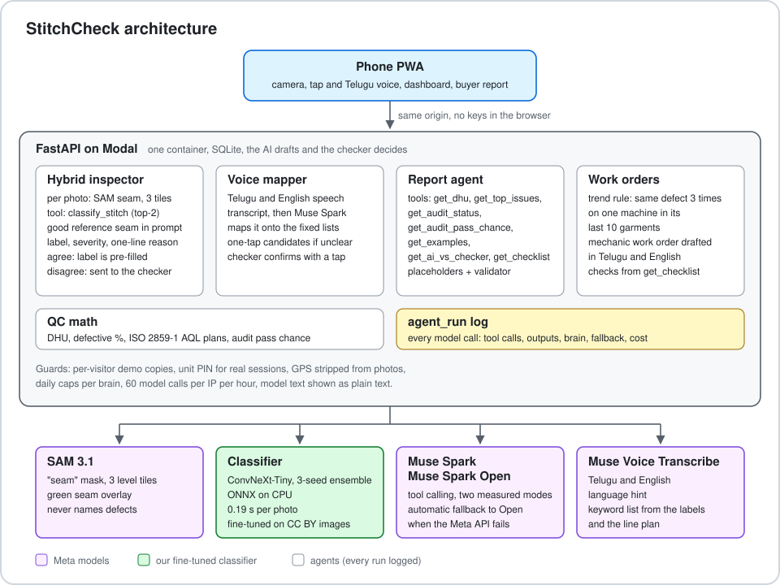

# StitchCheck

StitchCheck is a phone app that turns any worker into a reliable stitch inspector, so a new 25-machine garment unit in rural Andhra Pradesh can prove factory-grade quality and win orders. The checker photographs each critical seam; SAM 3.1 finds the seam, a small classifier fine-tuned on stitch images scores it, and Muse Spark judges the photo with the classifier as a tool, explains its call in one line and hands the uncertain ones to the checker. Corrections can be spoken in Telugu. Every confirmed defect feeds a live dashboard by machine and operation, trend alerts with work orders for the mechanic, an AQL audit plan, and an end-of-day buyer report whose every number is filled in by the server from logged data. Built for the Meta Global AI Developer Hackathon (Oct 26 to Nov 4, 2026).

**Headline result** (held-out fabrics, `results/test/summary.csv`): with the classifier as its tool and the checker deciding the photos where the two disagree, StitchCheck catches **92.9%** of major defects [89.7, 95.9]. Muse Spark alone catches 53.2%; the classifier alone 92.1%. The specialist sees the stitches, Muse Spark decides, explains and runs the day, and the checker has the final word.

- Demo video: TODO
- Live app: https://jvpnath--stitchcheck-web-web.us-east.modal.run (seeded demo day, labelled "Demo data")

## What it does

Muse Spark runs quality control for a small garment unit, with a small specialist model as one of its tools.

1. **Judges every photographed seam.** The checker photographs the critical seams of each garment, any suspicious seam, and a random spot check on 1 garment in 10. SAM 3.1 finds the seam; a classifier fine-tuned on stitch images scores tiles cut along it; Muse Spark calls that classifier as a tool, compares the seam with a good reference seam, and gives a label, severity and a one-line reason. When the two disagree, the photo goes to the checker.
2. **Takes corrections in Telugu.** The checker taps Agree, Change, Not a defect or Retake, or speaks a correction in Telugu and English; Muse Spark maps it onto the fixed lists and the checker confirms with a tap.
3. **Counts and warns.** Live DHU and defective %, by machine, operation and defect; trend alerts when one machine repeats a defect, each with a work order for the mechanic drafted by Muse Spark; the AQL 2.5 audit plan, its status, and the chance the lot passes a buyer's audit at today's rate.
4. **Writes the report the buyer can check.** Muse Spark writes the end-of-day buyer report and supervisor actions (Telugu and English) from tool results only: every number is filled in by the server from logged data, a validator rejects any number the model typed, and the full agent trace is one tap away.

**AI drafts, the checker decides.** Nothing is logged as a defect until the checker confirms it, and every photo keeps the classifier's output, the AI's verdict and the checker's decision.

**Process first.** Defects are about the process, not the person: the dashboard leads with machines and operations, per-operator counts are a supervisor-only view for training, and the AI never names, ranks or blames a worker.

## Why it matters

Small garment units in India have to prove their quality before a buyer will give them orders, and a new unit has no track record to show. Paper checklists miss defects, depend on one experienced checker, and give the buyer no data to verify. StitchCheck turns every check into a photo-backed record the buyer can audit, and the Muse Spark calls cost $1.021 per 100 garments on the StitchingNet test ($1.201 with Muse Spark Open), at 2.1 photos per garment (results/test/summary.csv). It is process first: the data points at machines and methods to fix, never at people to blame.

## Meta models used

| Model | Where |
|---|---|
| Muse Spark (`muse-spark-1.3`, Meta Model API) | The inspector's brain: hybrid judgment with the classifier as a tool, Telugu voice correction mapping, the report agent, mechanic work orders; reading buyer tech packs (offline evaluation below, not yet in the app) |
| Muse Spark Open (open weights, Modal shared endpoint) | The second, measured AI mode ("High sensitivity") and the automatic fallback when the Meta API fails; evaluated as arm E |
| SAM 3.1 | Finds the seam in each phone photo (tiles and the green overlay the checker sees); suggests the garment part. Never used to name defects |
| Muse Voice Transcribe | Telugu and English voice corrections, with a language hint and a keyword list |
| Muse Code | Built the phone app frontend (`app/`: every screen, the Telugu and English switch, offline-safe service worker) from the API contract in `app/SPEC.md` |

Two AI modes, each with its measured StitchingNet test figures (hybrid, checker in the loop):

| Mode | Major defects caught | Good seams flagged | Sent to the checker |
|---|---|---|---|
| Low false alarm (Muse Spark, default) | 92.9% | 9.5% | 21.7% |
| High sensitivity (Muse Spark Open) | 94.4% | 20.2% | 25.7% |

## Architecture



```
Phone PWA (camera, tap and voice, dashboard, report)
   |
FastAPI on Modal (one container, SQLite)
   |-- SAM 3.1: "seam" -> mask -> 3 tiles along the seam, sized to the training stitch scale
   |-- Classifier: ConvNeXt-Tiny, 3-seed ensemble, ONNX on CPU (0.19 s per photo)
   |-- Muse Spark / Muse Spark Open (tool calling):
   |      classify_stitch -> classifier top-2   |  reports: get_dhu, get_top_issues, get_audit_status,
   |      good reference seam in the prompt      |  get_audit_pass_chance, get_examples, get_ai_vs_checker, get_checklist
   |-- Muse Voice Transcribe -> Muse Spark maps the correction
   |-- QC math: DHU, ISO 2859-1 AQL plans (checked against two public tables), audit pass chance
   |-- agent_run log: every model call with its tool calls, outputs, brain, tokens and cost
```

## Results

Every number traces to a script and a file under `results/`. Settings were chosen on a validation fabric (Linen) and locked before any test run (`docs/design.md`, tag `test-lock-2`).

### StitchingNet test (held-out fabrics: Cotton and Oxford)

Headline metric: recall on major defects (skipped stitch, broken stitch, stain), the defects that fail a buyer audit. 420 test images (84 per class) plus 60 images of defect types no model was trained on. 95% intervals in brackets.

| System | Major recall | Good seams flagged | Macro-F1 | Sent to checker |
|---|---|---|---|---|
| **StitchCheck: Muse Spark + classifier, checker in the loop** | **0.929** [0.897, 0.959] | 9.5% | n/a | 21.7% |
| StitchCheck, label shown to the checker | 0.893 [0.855, 0.929] | 1.2% | 0.891 | n/a |
| StitchCheck with Muse Spark Open, checker in the loop (arm E) | 0.944 [0.915, 0.971] | 20.2% | n/a | 25.7% |
| StitchCheck with Muse Spark Open, label shown (arm E) | 0.925 [0.890, 0.956] | 16.7% | 0.847 | n/a |
| Classifier alone (ConvNeXt-Tiny, 3 seeds) | 0.921 [0.887, 0.952] | 8.3% | 0.887 | 0% |
| Muse Spark with a good-seam reference | 0.595 [0.533, 0.657] | 0% | 0.618 | 0% |
| Muse Spark Open with a good-seam reference (arm E) | 0.714 [0.660, 0.770] | 11.9% | 0.640 | 0% |
| Muse Spark zero-shot | 0.532 [0.470, 0.596] | 0% | 0.579 | 0% |
| Muse Spark Open zero-shot (arm E) | 0.623 [0.564, 0.683] | 1.2% | 0.616 | 0% |

- **Sent to checker:** the photos where the AI and the classifier disagree, which the app marks for the checker to decide instead of logging a label itself.
- **Label shown to the checker:** the label the app pre-fills on every photo, including the ones sent to the checker; the checker agrees with one tap or changes it.
- **Arm E caveat:** Muse Spark Open runs at reasoning effort "low", the lowest its endpoint accepts; the Muse Spark arms ran at "minimal". Model and effort are confounded in these comparisons.

With the checker deciding the 21.7% of photos where the two disagree, StitchCheck catches 92.9% of major defects (classifier alone 92.1%; difference +0.8 points [0.0, 2.0]). If the checker simply accepts the pre-filled label, false alarms on good seams drop from 8.3% to 1.2%, at a cost of 2.8 points of major recall [0.8, 4.9]. Muse Spark Open catches more major defects than Muse Spark in every arm (zero-shot +9.1 points [5.0, 13.6]; hybrid, label shown +3.2 [0.8, 5.8]) and flags more good seams (hybrid +10.7 to +15.5 points). The hybrid takes a median 1.7 s per photo with Muse Spark (2.7 s with Muse Spark Open) and costs about $0.49 per 100 photos ($0.57).

Muse Spark on its own misses about half of the major defects: it almost never names a skipped stitch (0 to 2% recall) and passes about half the stains as good. It never flags a good seam, so its errors all go one way. A good-seam reference helps (+6.3 points of major recall [2.4, 10.4]). On StitchingNet the reference comes from a training fabric, not the test fabric, so few-shot is understated there; the phone set uses references sewn on the same fabric.

**Muse Spark never flagged "unknown defect" on StitchingNet**, in any arm, on 60 images of defect types the classifier was never trained on. In the hybrid those images are caught as disagreements (5% called good), not as new defects. The open-seam pairs in the phone test set are the second test of this.

Full tables: `results/test/summary.csv`, `per_class.csv`, `paired.csv` (`scripts/test/analyse.py`). StitchingNet frames of the same defect are correlated, so these intervals are on the narrow side.

### Phone test set (Kadiri, real shirting cotton, phone photos)

TODO: all arms on 48 test pairs (190 photos), pair-bootstrap intervals; the Day 5 decision rule result. The photos reached us as WhatsApp-compressed copies (1040 to 1600 px), so these numbers are a lower bound for full-resolution capture.

### Tech-pack reader (offline evaluation, not yet in the app)

Can Muse Spark read a buyer's tech pack into an inspection plan that code can check? The extraction module and its evaluation are built; the app screen is the next step.

TODO: field accuracy and hallucinations on the unseen sheets (headline) and the seen sheets, as preregistered in `docs/techpack_eval.md`.

## Known limitations and next improvements

- **Skipped stitches can leak through the label shown to the checker.** The classifier's skipped-stitch calls are protected from being relabelled good or crooked only when its probability is at least 0.60. Below that, the AI's "good" or "crooked seam" is pre-filled: skipped-stitch recall of the shown label is 0.667 against the classifier's 0.702. The 0.60 threshold and the rule were fixed on validation data and are not changed after seeing test results; a lower threshold is the next improvement to test on new validation data.
- **Muse Spark does not name new defect types** on StitchingNet (above).
- **Puckering is untested.** Muse Spark may suggest it and the checker decides, but no test set has puckering (no CC BY data; the phone pairs were not sewn).
- **Phone photos are the real test.** StitchingNet is lab swatches from a fixed camera; results on phone photos of real shirts are reported above when the phone set is scored.
- **Tech packs are read offline only.** The tech-pack extraction is evaluated (above) but has no screen yet; the day plan is entered on the Start sheet.
- **Curved seams.** Tiles are rotated along the seam's overall direction, so on a curved or V-shaped seam each tile sits slightly off level.
- **Stitch scale on matching thread.** When the stitch pitch cannot be measured (matching thread, little contrast), tile size comes from a hand calibration on a reference photo at the fixed capture distance.

## Security and privacy

- **API keys stay on the server.** `MODEL_API_KEY` and the Modal proxy token live in a Modal secret; the browser never sees them.
- **No location in photos.** Every upload is re-encoded with EXIF rotation applied and the metadata dropped, so GPS never reaches storage.
- **Per-visitor demo copies.** Each visitor to the public URL gets their own copy of the seeded demo day, so nobody sees or changes another visitor's data.
- **Unit PIN for real sessions.** Sessions that are not demo data need the unit's PIN.
- **Spend caps.** Daily caps per brain ($10 Muse Spark, $5 Muse Spark Open) and 60 model calls per visitor IP per hour.
- **Model text is plain text.** Verdict reasons, work orders and reports are rendered as text, never as HTML.
- **The report validator.** A buyer report cannot contain a number or ID the model typed: the model writes placeholders, the server fills them from logged data, and any bare number is rejected.

## Built during the hackathon

Before Oct 26: research and planning documents only (no code). Day 0 preparation (Oct 25: repository scaffold, data audit, split proposal) is disclosed here; no code was reused from earlier projects. All code was written during the hackathon; the commit history shows when.

- [x] Dataset download, licence audit and leave-2-fabrics-out split (CC BY images only)
- [x] Phone test set ingest (WhatsApp export to labelled manifest) and photo review page
- [x] Stitch classifier fine-tuned on StitchingNet-Seg (ConvNeXt-Tiny, frozen BatchNorm search, 3-seed ensembles, trained on Modal GPUs)
- [x] Muse Spark zero-shot, few-shot and hybrid evaluation; Muse Spark Open (arm E); locked test protocol
- [x] SAM 3.1 seam localisation, tiling at the training stitch scale, seam overlay
- [x] Hybrid inspector (Muse Spark with the classifier as a tool), two measured AI modes with automatic fallback
- [x] Telugu voice correction (number words, one-tap candidates when unclear)
- [x] QC agent: defect log, DHU, ISO 2859-1 AQL audit, audit pass chance, trend alerts with mechanic work orders, verified end-of-day report
- [x] Tech-pack extraction with a preregistered evaluation (offline; not yet a screen in the app)
- [x] Backend API, ONNX serving, Modal hosting, seeded demo day
- [x] Phone app and dashboard (built with Muse Code)
- [ ] Phone test set results and Day 5 decision

## Data and licences

The StitchingNet authors declined use beyond the non-commercial license, so the classifier is trained only on CC BY data and covers four defects. Muse Spark can still suggest puckering for the checker to decide, but puckering is untested: there is no CC BY puckering data, and the planned puckering pairs in the phone set were not sewn.

| Dataset | Licence | Use |
|---|---|---|
| [StitchingNet-Seg](https://doi.org/10.6084/m9.figshare.31222708) (Park, Jung and Kim, 2026) | CC BY 4.0 | The only image source for training and evaluation: good seams, four defect classes (skipped, broken, crooked, stain) and three unseen defect classes |
| Phone test set (ours) | Not redistributed | Real out-of-distribution test: three shirting cottons sewn with deliberate defects (good, skipped, broken, crooked, stain, open seam), photographed on a phone |
| Tech-pack sheets (ours) | MIT, with the code | Seven fictional sample spec sheets for "Sample Buyer Co." (not a real company) |

The CC BY-NC release of [StitchingNet](https://www.kaggle.com/datasets/hyungjung/stitchingnet-dataset) (Kim et al.) was used once, before training, to check licence coverage (`results/audit/`). No model is trained or evaluated on it, and every split row is checked to be CC BY when it is loaded.

Dataset images and phone photos are not redistributed in this repository. The repo contains only download scripts, manifests (file names and hashes), split files, labels and metrics. `data/manifests/stitchingnet_seg.csv` lists every image used.

## How to run

```sh
python3 -m venv .venv && .venv/bin/pip install -e '.[data,api,ml,serve,cloud,dev]'
cp .env.example .env                        # add MODEL_API_KEY (and the Modal proxy token for Muse Spark Open)

.venv/bin/python -m stitchcheck.data.download   # StitchingNet-Seg (CC BY) into data/raw/
.venv/bin/python -m stitchcheck.data.manifest   # data/manifests/stitchingnet_seg.csv
.venv/bin/python -m stitchcheck.data.splits     # data/splits/stitchingnet_v2.csv

# Classifier (Modal GPUs): search, final 3-seed models, ensemble report
.venv/bin/modal run scripts/cloud/train_modal.py --jobs scripts/cloud/jobs_final.txt
.venv/bin/python scripts/export/onnx_ensemble.py            # models/demo_ensemble.onnx

# Locked StitchingNet test and analysis
.venv/bin/python scripts/test/run_arms.py                   # only from the test-lock-2 commit
.venv/bin/python scripts/test/run_arm_e.py
.venv/bin/python scripts/test/analyse.py

# App
.venv/bin/uvicorn stitchcheck.backend.app:default_app --factory
.venv/bin/modal deploy scripts/cloud/serve_modal.py         # hosted

.venv/bin/python -m pytest -q
```

On macOS, if the repo lives under ~/Desktop or ~/Documents, files there can get the hidden flag and Python 3.13+ then skips the editable install's `.pth` file. Create the venv elsewhere and symlink it: `python3 -m venv ~/.venvs/stitchcheck && ln -s ~/.venvs/stitchcheck .venv`.

## Licence

Code: MIT. Datasets keep their own licences (see above).
